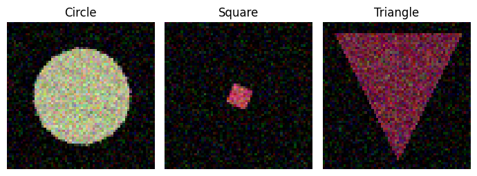

# Shape Detection with CNNs and OpenCV

A CSCI 650 study by Aditya Ori comparing a small convolutional neural network with a contour-based classifier. The notebook generates circles, squares, and triangles with randomized color, size, rotation, noise, and occasional occlusion.

[Notebook and saved results](shape-detection.ipynb) · [Open in Colab](https://colab.research.google.com/github/adi0ri/shape-detection-cnn-opencv/blob/main/shape-detection.ipynb)



## Benchmark

The dataset has 300 generated images. The CNN trains on 192 images and uses 48 for validation. Both classifiers are scored on the same 60 held-out images, with 20 from each class. The OpenCV baseline uses Canny edges and the vertex counts of approximated contours.

| Method | Correct | Accuracy |
| --- | ---: | ---: |
| TensorFlow CNN | 46 / 60 | 76.7% |
| OpenCV contours | 42 / 60 | 70.0% |

These are the saved results from one seeded run on the synthetic dataset. The archived course notebook used a different scoring procedure. This edition matches each prediction to its own label and evaluates both methods on one held-out set.

## Run locally

With Python 3.13:

```sh
python -m pip install -r requirements.txt jupyterlab
python -m jupyterlab shape-detection.ipynb
```

Run the cells in order. The study generates its own data. An optional final cell runs VGG16 and ResNet50 on an image you provide and downloads their pretrained weights if enabled.
